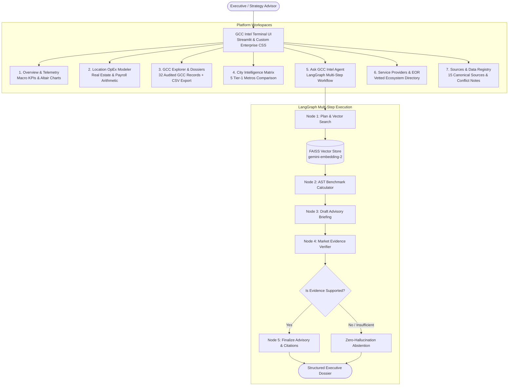

# GCC INTEL — India's GCC Market Intelligence Terminal

> **Enterprise-grade market intelligence terminal for evaluating, establishing, and scaling Global Capability Centres (GCCs) across India.**  
> Built as an autonomous research advisory platform for enterprise executives, corporate real estate heads, and strategy advisors.

[](https://cu5axikwdfpfurctzwhxtp.streamlit.app/)
[](https://github.com/SURYAMS002/gcc)
[](https://python.org)
[](https://langchain.com)
[](https://ai.google.dev)

---

### 🌐 Live Production Deployment
* **Live Interactive Platform:** [https://cu5axikwdfpfurctzwhxtp.streamlit.app/](https://cu5axikwdfpfurctzwhxtp.streamlit.app/)
* **Dedicated GitHub Repository:** [https://github.com/SURYAMS002/gcc](https://github.com/SURYAMS002/gcc)

---

## 1. Executive Summary & Problem Context

Global enterprises evaluating India for their next-generation Global Capability Centre face fragmented, outdated, and unverified data across multiple channels:
* **Blended & Opaque Real Estate Numbers:** Reports quote single city-wide averages, obscuring dramatic variances between micro-markets (e.g., Bengaluru Outer Ring Road at ₹125/sq.ft/mo vs. Electronic City at ₹55/sq.ft/mo).
* **Announcement Inflation vs. Real Ground Reality:** Corporate press releases routinely conflate multi-year prospective hiring announcements with actual current operational headcounts.
* **Buried State Policies & Subsidies:** Statutory incentives (*Karnataka GCC Policy 2024*, *Tamil Nadu R&D Policy 2022*, *Telangana TS-iPASS*) are buried in state gazettes with obscure compliance thresholds.
* **LLM Hallucinations:** Off-the-shelf AI chatbots invent office locations, hallucinate salary ranges, and generate dead or fabricated links.

**GCC Intel** addresses these issues with an audited dataset, grounded multi-hop RAG retrieval, real-time OpEx arithmetic, and an anti-hallucination abstention policy.

---

## 2. Platform Architecture & Data Pipeline



---

## 3. Core Modules & Key Features

### 🧮 1. Interactive Location Cost & Setup Modeler (New)
* **Real-time Financial Simulation:** Select target city (**Bengaluru, Hyderabad, Chennai, Pune, Gurugram**), headcount slider (**50 to 1,000 employees**), and primary function (**Cloud Engineering, Data Science / AI, Quant Finance, Hardware R&D**).
* **Automated OpEx Arithmetic:**
  * Space requirement calculated at 90 sq.ft/seat (commercial tech park standard).
  * Annual commercial lease budget in **INR Crores** and **USD Millions** using CBRE Q2 2024 benchmarks.
  * Annual tech payroll base benchmarked against Michael Page 2024 compensation matrices.
  * Total annual operating expenditure (OpEx) run-rate.
  * Direct state subsidy callouts (e.g., Tamil Nadu training subsidy up to ₹4,000/seat/month, Haryana employment creation grants).
  * Micro-market recommendation breakdown with specific vacancy rates and rent ranges.

### 🏢 2. Curated GCC Explorer & Dossiers
* **32 Audited GCC Profiles:** Covering Fortune 500 leaders across BFSI, Tech, Retail, Automotive, Aerospace, and Life Sciences (Goldman Sachs, Boeing BIETC, JPMorgan Chase, Walmart Global Tech, AstraZeneca, Mercedes-Benz, Ford, etc.).
* **Granular Data Points:** Setup year, current headcount, global parent HQ, operational business functions, verified micro-market address, and recent expansion signals.
* **Verification Tiers:** Transparent quality tagging (`Verified Fact` 🟢, `Company Announcement` 🔵, `Industry Estimate` 🟡).
* **📥 CSV Export:** One-click download of the entire audited 32-record database for offline financial modeling.

### 🏙️ 3. City Intelligence & Comparative Workspace
* **5 Tier-1 Ecosystems Monitored:** In-depth comparative intelligence across Bengaluru, Hyderabad, Chennai, Pune, and Gurugram (Delhi-NCR).
* **Comparative Dimensions:**
  * **Ecosystem Share:** NASSCOM market share %, estimated total GCCs, and active workforce pool.
  * **Commercial Real Estate:** Grade-A lease ranges, micro-market rent variances, and net absorption.
  * **Compensation Benchmarks:** Salary bands across Junior (0-3 yrs), Mid (4-8 yrs), Senior (9-14 yrs), and Principal/Director (15+ yrs) tiers.
  * **Statutory Frameworks:** Karnataka GCC Policy 2024, Tamil Nadu R&D Policy 2022, Telangana TS-iPASS, Maharashtra IT Policy 2023, Haryana ESDM Policy.
  * **Strategic Trade-offs:** Explicit Pros, Cons, and Recommended Entrant Profiles for each metro.
* **AI Comparative Synthesis:** Automated location trade-off generation comparing selected cities.

### 🧠 4. Ask GCC Intel (Agentic Research Engine)
* **LangGraph Orchestration:** Multi-node execution graph (`plan_and_search` ➔ `calculate` ➔ `draft_answer` ➔ `verify` ➔ `finalize`).
* **Semantic Vector Retrieval:** Embedded with `gemini-embedding-2` over structured dossiers, city profiles, and policy gazettes.
* **Safe Mathematical Computations:** Deterministic Python AST expressions for lease differentials and cost multipliers.
* **Audit Trail:** Every claim is bound to primary source links (`[Title](URL)`). If data is absent, the agent strictly refuses to invent answers.

### 🤝 5. Service Providers & Ecosystem Partners
* Directory of vetted enablement partners across:
  * **Market Entry & Setup Strategy:** ANSR, Zinnov, EY, PwC.
  * **Legal & Regulatory Advisory:** Shardul Amarchand Mangaldas, Trilegal.
  * **Commercial Real Estate Advisors:** CBRE, JLL.
  * **Executive Search & Compensation:** Michael Page.
  * **Employer of Record (EOR) & Incubation:** Deel, ANSR Workspace.

### 📚 6. Data Quality & Sources Registry
* Full inventory of 15 canonical primary publications, government gazettes, and industry reports (NASSCOM, CBRE India Office Figures Q2 2024, Michael Page India Salary Guide 2024, state government gazettes).
* Explanatory notes on handling data disagreements and reporting discrepancies.

---

## 4. Curated Strategic Inquiries (What You Can Ask)

| Category | Recommended Test Question | Expected Output & Validation |
| :--- | :--- | :--- |
| **BFSI & FinTech** | *"Which cities should a US fintech company consider for a 300-person GCC?"* | Compares Bengaluru vs Hyderabad vs Chennai across tech talent depth, Grade-A rents, and financial domain expertise. |
| **Real Estate & OpEx** | *"Compare commercial office lease outlays between Outer Ring Road Bengaluru and HITEC City Hyderabad."* | Retrieves micro-market ranges (₹105-145 vs ₹70-95/sq.ft/mo) with cost savings calculations. |
| **Life Sciences & R&D** | *"Where are India's leading healthcare and pharmaceutical R&D GCCs located, and what functions do AstraZeneca and Novartis run?"* | Surfaces Chennai and Hyderabad, identifying AstraZeneca's clinical center and Novartis's Genome Valley site. |
| **State Incentives** | *"What state incentives are available in Tamil Nadu vs Karnataka for establishing a new GCC?"* | Cites Tamil Nadu R&D Policy 2022 (training subsidy up to ₹4,000/seat/mo) vs Karnataka GCC Policy 2024 (EPF & lease concessions). |
| **Automotive & Hardware** | *"Which Indian hub has the highest concentration of automotive embedded software and aerospace R&D GCCs?"* | Identifies Pune (Mercedes-Benz R&D) and Bengaluru (Boeing BIETC aerospace center). |
| **Anti-Hallucination Guardrail** | *"Does Apple or Tesla have an audited secret GCC in Antarctica?"* | Demonstrates strict refusal/abstention: explicitly states that no verified record exists rather than speculating. |

---

## 5. Technology Stack

| Layer | Component | Detail |
| :--- | :--- | :--- |
| **UI Framework** | Streamlit 1.61+ | Wide executive dashboard layout, custom dark terminal styling |
| **Data Visualizations** | Altair & Pandas | Responsive horizontal & grouped bar charts for market share and rents |
| **Agent Workflow** | LangGraph 1.2+ | Directed acyclic state graph (`StateGraph`) with typed state channels |
| **LLM Inference** | Google Gemini (`gemini-3.8-flash`) | Low-latency inference via Google GenAI SDK |
| **Embeddings** | Google Gemini (`gemini-embedding-2`) | 3072-dimensional semantic vectors |
| **Vector Storage** | FAISS CPU (`faiss-cpu`) | In-memory cosine similarity indexing with persistent on-disk cache |
| **Deterministic Math** | Python AST Calculator | Safe mathematical calculation parser |
| **Configuration** | `python-dotenv` & Streamlit Secrets | Zero credential exposure |

---

## 6. How to Run Locally

### 1. Clone Repository & Setup Virtual Environment
```powershell
git clone https://github.com/SURYAMS002/gcc.git
cd gcc
python -m venv .venv
.\.venv\Scripts\Activate.ps1
```

### 2. Install Requirements
```powershell
pip install -r requirements.txt
```

### 3. Set Up API Key
Create a `.env` file in the project root:
```env
GEMINI_API_KEY=your_gemini_api_key_here
```
*(You can obtain a free Gemini API key from [Google AI Studio](https://aistudio.google.com/app/apikey).)*

### 4. Build or Validate the FAISS Index
```powershell
python -c "from rag.knowledge_indexer import build_or_load_gcc_index; build_or_load_gcc_index()"
```

### 5. Launch Application
```powershell
streamlit run app.py
```
Open your browser at `http://localhost:8501`.

### 6. Run Automated Test Suite
```powershell
python -m unittest tests/test_gcc_platform.py
```

---

## 7. Project Isolation Notice

**GCC Intel** is an independent, dedicated repository and application:
* **GCC Intel Repo:** [https://github.com/SURYAMS002/gcc](https://github.com/SURYAMS002/gcc)
* **GCC Intel Live App:** [https://cu5axikwdfpfurctzwhxtp.streamlit.app/](https://cu5axikwdfpfurctzwhxtp.streamlit.app/)
* **FinSight Repo (Original):** [https://github.com/SURYAMS002/Finsight](https://github.com/SURYAMS002/Finsight)
* **FinSight Live App (Original):** [https://finsight-rgedparqy6zxxjkca8yrgt.streamlit.app/](https://finsight-rgedparqy6zxxjkca8yrgt.streamlit.app/)

Neither project overrides, modifies, or depends upon the other.

---

## 8. License & Attribution

Developed as a specialized market intelligence platform for the Flexiple Product Internship assignment.  
Data grounded in public government gazettes, NASSCOM GCC 4.0 reports, CBRE India Office Market reports, and Michael Page India Salary guides.
