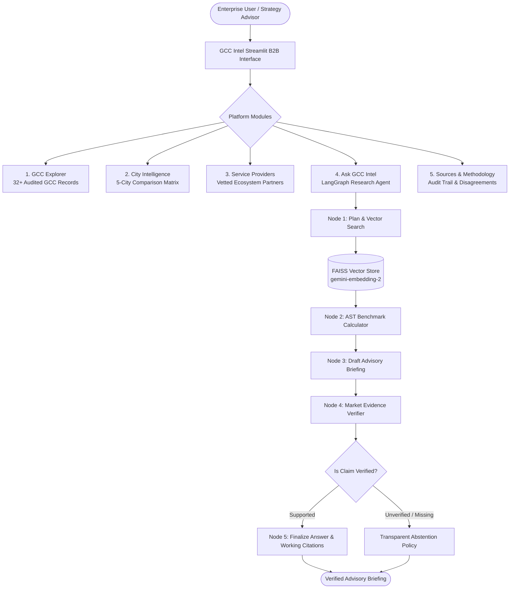

# GCC Intel — India's GCC Market Intelligence Platform

> **GCC Intel** is an AI-powered market intelligence platform engineered to help global enterprises, strategy advisors, and corporate expansion teams evaluate, establish, and scale Global Capability Centres (GCCs) across India's premier tech hubs.

[](https://finsight-rgedparqy6zxxjkca8yrgt.streamlit.app/)
[](https://github.com/SURYAMS002/Finsight)

🌐 **Live 24/7 Web Application:** [https://finsight-rgedparqy6zxxjkca8yrgt.streamlit.app/](https://finsight-rgedparqy6zxxjkca8yrgt.streamlit.app/)

---

## 1. Problem Statement

Global enterprises evaluating India for their first GCC face fragmented, inconsistent, and difficult-to-verify data:
* **Conflicting Benchmarks:** Commercial lease rates vary widely across micro-markets (e.g., Bengaluru Outer Ring Road vs. Whitefield), yet reports publish single blended averages.
* **Unsubstantiated Marketing Claims:** Announcements often conflate multi-year future hiring targets with current on-the-ground headcount.
* **Complex State Incentives:** Incentive policies (Karnataka GCC Policy 2024, Tamil Nadu R&D Policy 2022, Telangana ICT Policy) are buried in state gazettes with unclear eligibility rules.
* **LLM Hallucinations:** Generic conversational AI models invent company locations, fabricate salaries, or cite dead links.

**GCC Intel** solves this through structured data modeling, verifiable source tracking, automated claim audits, and transparent confidence tiers.

---

## 2. Core Capabilities & Architecture



---

## 3. Product Modules

### A. GCC Explorer
* **Audited Directory:** Search and filter 32+ verified GCCs (JPMorgan Chase, Goldman Sachs, Boeing BIETC, AstraZeneca, Ford, Walmart, Target, etc.).
* **Granular Attributes:** Parent company & global HQ, Indian city/state, industry, business functions, establishment year, tracked workforce, recent announcements, and canonical source link.
* **Confidence Tiers:** Transparent badges for `Verified Fact` 🟢, `Company Announcement` 🔵, and `Industry Estimate` 🟡.

### B. City Intelligence & Comparison Workspace
* **5 Monitored Hubs:** Bengaluru, Hyderabad, Chennai, Pune, and Gurugram (Delhi-NCR).
* **Side-by-Side Comparison:**
  * **Ecosystem Profile:** Market share %, estimated GCC count, workforce size, marquee names.
  * **Commercial Real Estate (CBRE Q2 2024):** Grade-A lease rental ranges, micro-market breakdown, vacancy rates.
  * **Talent Benchmarks (Michael Page 2024):** Software Engineering, AI/ML, and Risk Analyst salary ranges across seniority levels, plus attrition rates.
  * **State Policies & Incentives:** Karnataka GCC Policy 2024, Tamil Nadu R&D Policy 2022, Telangana TS-iPASS, Maharashtra IT Policy 2023, Haryana ESDM Policy.
  * **Infrastructure:** International airport flight connectivity, metro rail lines, power reliability.
  * **Strategic Trade-offs:** Detailed Pros, Cons, and Recommended Entrant Profiles.
* **AI Comparative Synthesis:** One-click automated trade-off advisory powered by Gemini 3.8 Flash.

### C. Ask GCC Intel (Conversational Research Agent)
* **Agentic LangGraph Engine:** Multi-step pipeline (`plan_and_search` ➔ `calculate` ➔ `draft_answer` ➔ `verify` ➔ `finalize`).
* **Semantic Vector Retrieval:** Uses `gemini-embedding-2` to retrieve exact paragraphs, state policy sections, and company records.
* **Strict Grounding:** Every substantive claim includes a working markdown hyperlink `[Source Title](URL)`.
* **Zero-Hallucination Abstention:** If evidence is missing, the agent explicitly abstains:
  > *"I couldn't find sufficient verified evidence in the GCC Intel dataset to answer this question reliably."*

### D. Service Provider Directory
* **Enablement Partners:** Strategy & market entry (ANSR, Zinnov, EY, PwC), legal & tax (Shardul Amarchand Mangaldas, Trilegal), real estate (CBRE, JLL), recruitment (Michael Page), and Employer of Record incubation (Deel, ANSR Workspace).

### E. Sources & Data Quality Registry
* **Audit Trail:** Exhaustive registry tracking source title, publisher, canonical URL, publication date, and last verified timestamp.
* **Conflict Resolution:** Dedicated documentation on why commercial rents differ by micro-market and how target headcounts differ from on-the-ground employees.

---

## 4. Technology Stack

* **Frontend & Web UI:** Streamlit 1.61+ (Dark FinTech enterprise styling)
* **Agent Workflow & Orchestration:** LangGraph 1.2+ (`StateGraph`)
* **LLM Engine:** Google Gemini (`gemini-3.8-flash` via `google-genai` SDK)
* **Embedding Model:** Google Gemini (`gemini-embedding-2` - 3072 dims)
* **Vector Index:** FAISS CPU (`faiss-cpu`) with cosine similarity
* **Data Processing & Analytics:** Pandas, NumPy, Python AST parser
* **Configuration & Secrets:** `python-dotenv` & Streamlit Cloud Secrets

---

## 5. How to Run Locally

### 1. Clone & Setup Virtual Environment
```powershell
git clone https://github.com/SURYAMS002/Finsight.git
cd Finsight
python -m venv .venv
.\.venv\Scripts\Activate.ps1
```

### 2. Install Dependencies
```powershell
pip install -r requirements.txt
```

### 3. Configure API Key
Create a `.env` file in the project root:
```env
GEMINI_API_KEY=YOUR_GEMINI_API_KEY_HERE
```
*(Note: Never commit `.env`. It is ignored by `.gitignore`.)*

### 4. Build or Verify Knowledge Index
```powershell
python -c "from rag.knowledge_indexer import build_or_load_gcc_index; build_or_load_gcc_index()"
```

### 5. Launch Application
```powershell
streamlit run app.py
```

### 6. Run Test Suite
```powershell
python -m unittest tests/test_gcc_platform.py
```

---

## 6. Security & Data Governance

* **Zero Hardcoded Secrets:** `GEMINI_API_KEY` is loaded dynamically from `.env`, Streamlit Cloud Secrets, or the sidebar user input box.
* **Safe Mathematical Evaluation:** Math formulas are parsed using Python's Abstract Syntax Tree (AST) rather than unsafe `eval()`.
* **Git Hygiene:** Local vector caches (`faiss_store/`, `faiss_gcc_store/`), temporary files, virtual environments, and `.env` are excluded via `.gitignore`.
